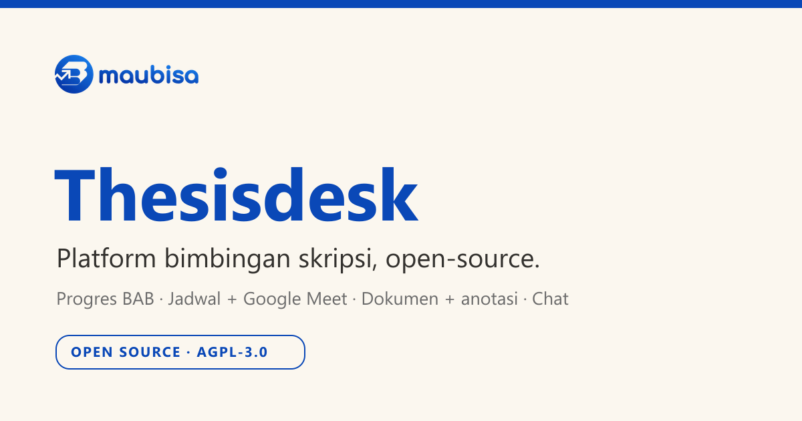

<div align="center">

<picture>
  <source media="(prefers-color-scheme: dark)" srcset="./.github/assets/maubisa-logo-white.png">
  
</picture>

# Thesisdesk

**Satu ruang untuk bimbingan skripsi, dari progres BAB sampai sidang.**

Platform bimbingan skripsi yang siap dipakai kampus, instansi, atau tim bimbingan mandiri: progres
BAB, penjadwalan sesi plus Google Meet, dokumen berversi dengan anotasi inline, dan chat tutor-klien.
Kode ini kami pakai sungguhan di `thesis.maubisa.id`, lalu kami buka agar Anda tidak perlu mulai dari nol.

<p>
  <a href="https://thesis.maubisa.id"></a>
  <a href="https://github.com/maubisa-id/thesisdesk/generate"></a>
</p>

[](https://vercel.com/new/clone?repository-url=https://github.com/maubisa-id/thesisdesk)

<p>
  <a href="https://github.com/maubisa-id/thesisdesk/actions/workflows/ci.yml"></a>
  <a href="https://github.com/maubisa-id/thesisdesk/releases/latest"></a>
  <a href="./LICENSE"></a>
  <a href="https://github.com/maubisa-id/thesisdesk/commits/main"></a>
</p>

<p>
  <a href="https://nextjs.org/"></a>
  <a href="https://react.dev/"></a>
  <a href="https://www.typescriptlang.org/"></a>
  <a href="https://tailwindcss.com/"></a>
  <a href="https://www.prisma.io/"></a>
  <a href="https://www.better-auth.com/"></a>
</p>

<br/>



</div>

---

> [!TIP]
> **Coba dulu sebelum dipakai: [thesis.maubisa.id](https://thesis.maubisa.id).**
> Masuk sebagai klien `rina@student.ac.id`, tutor `andi.tutor@maubisa.id`, atau admin
> `admin@maubisa.id` (sandi `password123` untuk semuanya).

## Untuk siapa ini

Pakai Thesisdesk kalau Anda butuh salah satu dari berikut:

- Sistem bimbingan skripsi/tesis untuk kampus, program studi, atau lembaga bimbingan.
- Ruang kerja tutor-mahasiswa: progres bab, jadwal sesi, dokumen, dan diskusi dalam satu tempat.
- Fondasi yang aman dan rapi untuk dikembangkan sendiri, bukan mulai dari halaman kosong.

Bagian yang paling melelahkan, yaitu peran-akses yang benar (mahasiswa hanya melihat miliknya),
jejak audit, penjadwalan Google Meet, dan versi dokumen, sudah kami tangani. Anda tinggal ganti
merek, sesuaikan alur, dan jalankan.

## Kenapa ada

Membangun sistem bimbingan yang utuh itu makan waktu: dashboard per peran, papan progres, jadwal
plus tautan rapat, dokumen berversi dengan anotasi, pesan, sampai keamanan akses antar-mahasiswa.
Semua itu sudah jadi di sini, siap Anda pakai ulang. Fokusnya satu: **membantu mahasiswa lulus
lebih cepat, dengan tutor yang punya gambaran jelas.**

## Fitur

- **Dashboard per peran.** Mahasiswa (cincin progres BAB, jadwal, tugas), tutor (antrean review,
  klien yang macet 7 hari lebih, jadwal), admin (metrik plus jejak audit).
- **Progres BAB.** Papan Kanban milestone per bab (proposal, BAB 1-5, revisi, sidang) yang bisa
  dioperasikan penuh lewat keyboard.
- **Jadwal dan sesi.** Mahasiswa mengajukan, tutor menyetujui, tautan **Google Meet** dibuat
  otomatis, plus catatan sesi dan rekaman.
- **Dokumen berversi.** Unggah naskah, simpan versi, beri **anotasi inline** dan diskusi ber-thread
  langsung di dokumen.
- **Pesan.** Chat tutor-mahasiswa dengan indikator kehadiran.
- **Notifikasi.** Pemberitahuan dalam aplikasi (jadwal disetujui, berkas baru, pesan) dengan penanda
  belum-dibaca; email bersifat opsional lewat hub.
- **Keamanan.** Akses default-deny berbasis hak (scope thesis), RBAC terpusat yang mencegah
  mahasiswa mengintip data mahasiswa lain, jejak audit append-only, validasi zod, header keamanan,
  rate-limit, dan pengecekan tipe berkas dari magic-byte.
- **Federasi admin (opsional).** API tipis `/admin/v1/*` (JWT HS256 server-to-server, mati secara
  default) agar sebuah pusat operator bisa menugaskan tutor, mengatur judul, dan memantau beban
  tutor tanpa login ulang. Lihat [docs/federation-admin-api.md](./docs/federation-admin-api.md).

## Cara kerjanya

```
Mahasiswa  --ajukan sesi-->  Tutor  --review + anotasi-->  Dokumen berversi
    |                          |
    +------- Progres BAB ------+       (milestone per bab, papan Kanban)
    |
    +------- Chat + Notifikasi

Identitas / tagihan / hak akses  --(opsional, lewat env)-->  Hub  akun.maubisa.id
Aksi operator lintas-produk       --(opsional, /admin/v1 JWT)-->  Federasi admin
```

Aturan intinya: **state bimbingan hidup di aplikasi ini**, sedangkan identitas, tagihan, dan hak
akses bisa ditumpangkan ke sebuah hub (pola hub-and-spoke, tanpa foreign key lintas-DB). Integrasi
hub itu **opsional**: kosongkan env-nya dan Thesisdesk tetap berjalan mandiri, notifikasi tetap
tampil di dalam aplikasi.

## Tech stack

| Bagian | Teknologi |
|--------|-----------|
| Framework | [Next.js 16](https://nextjs.org/) (App Router, Server Components, Turbopack) |
| UI | [React 19](https://react.dev/) + [Tailwind CSS v4](https://tailwindcss.com/) + shadcn / Base UI |
| Bahasa | [TypeScript](https://www.typescriptlang.org/) (strict) |
| ORM | [Prisma 6](https://www.prisma.io/) (SQLite untuk dev, MySQL untuk produksi) |
| Auth | [Better Auth 1.6](https://www.better-auth.com/) (email + password, cookie SSO-ready) |
| Penyimpanan dokumen | [Google Cloud Storage](https://cloud.google.com/storage) (opsional; default lokal saat dev) |
| Desain | Sistem "Ruang Belajar yang Tenang" (cream + cobalt, Cabinet Grotesk + Geist, WCAG 2.2 AA) |

## Mulai cepat

Pilih salah satu cara memakai kode ini:

- **Tombol "Use this template"** (paling gampang): bikin repo baru milik Anda dengan riwayat bersih,
  [buka di sini](https://github.com/maubisa-id/thesisdesk/generate).
- **Salin langsung jadi folder baru** (tanpa membawa riwayat git):
  ```bash
  npx degit maubisa-id/thesisdesk nama-proyek-anda
  cd nama-proyek-anda
  ```
- **Fork lewat tombol di GitHub** kalau ingin tetap terhubung ke sumbernya, supaya gampang menarik
  pembaruan nanti.

Lalu jalankan (nol-setup, pakai SQLite):

```bash
npm install
cp .env.example .env          # minimal isi BETTER_AUTH_SECRET (openssl rand -base64 32)
npm run db:setup              # generate Prisma client + buat dev.db dari schema
npm run seed                  # data contoh + akun demo
npm run dev                   # http://localhost:3100
```

Atau sekali jalan dengan Docker (app + MySQL):

```bash
cp .env.example .env          # isi BETTER_AUTH_SECRET
docker compose up             # http://localhost:3100, migrasi + generate otomatis
```

**Akun demo (sandi `password123`):** admin `admin@thesisdesk.test`, tutor `andi.tutor@thesisdesk.test`
atau `sinta.tutor@thesisdesk.test`, mahasiswa `rina@student.ac.id`, `dinda@student.ac.id`,
`bagus@student.ac.id`. Butuh Node 22 (lihat [`.nvmrc`](./.nvmrc)).

## Environment

Semua variabel dijelaskan di [`.env.example`](./.env.example). Yang paling penting:

| Variabel | Wajib | Keterangan |
|----------|:-----:|------------|
| `DATABASE_URL` + `DB_PROVIDER` | ya | `file:./dev.db` (dev) atau `mysql://` (produksi) |
| `BETTER_AUTH_SECRET` / `BETTER_AUTH_URL` | ya | rahasia acak plus origin app |
| `ADMIN_EMAILS` | untuk admin | daftar email admin (dipisah koma) |
| `THESIS_ADMIN_API_SECRET` | untuk federasi | mengaktifkan API `/admin/v1/*`; samakan dengan hub |
| `NOTIFY_URL` / `NOTIFY_SECRET` | untuk email | kirim notifikasi lewat hub; kosong = tetap in-app |
| `GCS_*` | untuk dokumen | Google Cloud Storage; kosong = simpan lokal saat dev |

> [!IMPORTANT]
> Semua integrasi hub eksternal (notifikasi, akun, federasi) bersifat **opsional dan mati
> secara default**. Kosongkan env-nya dan aplikasi tetap berjalan penuh secara mandiri.

## Deploy

- **Vercel.** Klik tombol **Deploy with Vercel** di atas, sambungkan repo, lalu isi environment dari
  `.env.example`. `vercel.json` sudah menjalankan `prisma generate && prisma db push && next build`.
  Gunakan database terkelola (Neon, PlanetScale, Railway, atau sejenisnya) untuk `DATABASE_URL` dan
  set `DB_PROVIDER=mysql`, lalu set `BETTER_AUTH_URL` ke domain final dan deploy ulang.
- **Docker.** `docker compose up` menjalankan app plus MySQL sekali perintah. `Dockerfile` (multi-
  stage, standalone, non-root) tersedia di root.

## Buat jadi milik Anda

Template ini sudah bebas identitas Maubisa secara default (ikon generik, seed data netral, domain
contoh) - README ini saja yang sengaja mencantumkan atribusi ke proyek asal sebagai bentuk kredit.
Untuk memasang identitas Anda sendiri:

1. **Pasang merek Anda.** Ikon aplikasi adalah SVG inline di [`src/components/kit.tsx`](./src/components/kit.tsx)
   (tanpa file gambar, tinggal ganti bentuk/warnanya), favicon di [`src/app/icon.png`](./src/app).
   Atau, tanpa sentuh kode: isi nama dan URL logo institusi lewat wizard setup saat pertama kali
   dijalankan. Warna dan token ada di [`src/app/globals.css`](./src/app/globals.css).
2. **Sesuaikan data contoh.** Akun dan bimbingan demo ada di [`prisma/seed.ts`](./prisma/seed.ts).
3. **Matikan/hidupkan integrasi.** Semua integrasi hub bersifat env. Biarkan kosong untuk berdiri
   sendiri, atau isi untuk menyambung ke pusat akun dan federasi admin Anda.
4. **Deploy.** Cara tercepat: tombol **Deploy with Vercel**, bawa database terkelola sendiri. Untuk
   MySQL manual atau Docker, ikuti bagian Deploy di atas.

Panduan kontribusi dan standar kode ada di [CONTRIBUTING.md](./CONTRIBUTING.md).

## Struktur proyek

```
src/
  app/
    (app)/            # area login (shell + nav per peran)
      progres, jadwal, dokumen, chat, notifikasi
      klien           # tutor: klien saya
      admin/{pengguna,bimbingan,audit}       # panel admin
    admin/v1/         # API federasi (JWT S2S, env-gated)
    masuk, daftar     # auth
    api/{auth,cron,portal}
  components/{ui,shell,dashboard,features,auth,states,icons}
  lib/{prisma,auth,session,entitlement,rbac,audit,federation,actions,queries,
       notify,gcs,format,nav}
prisma/               # schema.prisma, seed.ts
```

## Skrip

| Skrip | Fungsi |
|-------|--------|
| `npm run dev` | server pengembangan (port 3100) |
| `npm run build` / `npm start` | build dan jalankan produksi |
| `npm run lint` | ESLint |
| `npm run db:setup` | generate Prisma client + buat/sinkron DB |
| `npm run seed` | isi data contoh dan akun demo |

## Keamanan

Akses bersifat default-deny: fitur bimbingan hanya terbuka untuk pengguna dengan hak aktif, dan
setiap query difilter per pengguna sehingga mahasiswa tidak bisa mengintip data mahasiswa lain.
Aksi sensitif tercatat di jejak audit append-only. Endpoint federasi memverifikasi tanda tangan JWT
secara timing-safe, menolak `alg=none`, dan mengecek ulang invariant-nya sendiri. Detail dan cara
melapor ada di [SECURITY.md](./SECURITY.md).

## Dokumentasi

| Dokumen | Isi |
|---------|-----|
| [CONTRIBUTING.md](./CONTRIBUTING.md) | Cara berkontribusi dan standar kode |
| [SECURITY.md](./SECURITY.md) | Kebijakan keamanan dan checklist produksi |
| [CODE_OF_CONDUCT.md](./CODE_OF_CONDUCT.md) | Pedoman perilaku komunitas |
| [docs/federation-admin-api.md](./docs/federation-admin-api.md) | Kontrak API federasi admin |
| [docs/federation-admin-api.openapi.yaml](./docs/federation-admin-api.openapi.yaml) | Spesifikasi OpenAPI 3.1 (Swagger/Postman) |
| [.env.example](./.env.example) | Semua variabel environment |

## Kredit dan atribusi

Template ini berasal dari [`maubisa-id/thesisdesk`](https://github.com/maubisa-id/thesisdesk) oleh
Maubisa / PT Litera Edu Solusi, dan menggerakkan [thesis.maubisa.id](https://thesis.maubisa.id).
Kalau Anda memakai atau memodifikasinya, kami akan senang bila atribusi dan tautan asalnya tetap
dicantumkan agar pengguna lain bisa menemukan sumbernya.

## Lisensi

[AGPL-3.0](./LICENSE), hak cipta 2026 PT Litera Edu Solusi (Maubisa). Bebas dipakai, dipelajari,
dimodifikasi, dan di-deploy, termasuk oleh kampus dan instansi. Karena AGPL, bila Anda menjalankan
versi modifikasi sebagai layanan jaringan untuk publik, source modifikasi itu ikut dibuka bagi
penggunanya. Logo dan nama "Maubisa" tetap milik PT Litera Edu Solusi; ganti dengan merek Anda
sendiri saat memakai.

---

<div align="center">
<sub>Dibuat oleh <a href="https://maubisa.id">Maubisa</a>. Menggerakkan <a href="https://thesis.maubisa.id">thesis.maubisa.id</a>.</sub>
</div>
